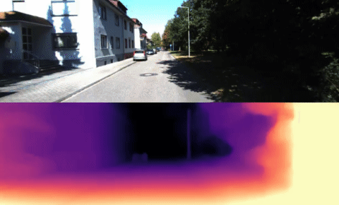

# Monodepth2

This is the reference PyTorch implementation for training and testing depth estimation models using the method described in

> **Digging into Self-Supervised Monocular Depth Prediction**
>
> [Clément Godard](http://www0.cs.ucl.ac.uk/staff/C.Godard/), [Oisin Mac Aodha](http://vision.caltech.edu/~macaodha/), [Michael Firman](http://www.michaelfirman.co.uk) and [Gabriel J. Brostow](http://www0.cs.ucl.ac.uk/staff/g.brostow/)
>
> [ICCV 2019 (arXiv pdf)](https://arxiv.org/abs/1806.01260)

<p align="center">
  
</p>

This code is for non-commercial use; please see the [license file](LICENSE) for terms.

If you find our work useful in your research please consider citing our paper:

```
@article{monodepth2,
  title     = {Digging into Self-Supervised Monocular Depth Prediction},
  author    = {Cl{\'{e}}ment Godard and
               Oisin {Mac Aodha} and
               Michael Firman and
               Gabriel J. Brostow},
  booktitle = {The International Conference on Computer Vision (ICCV)},
  month = {October},
year = {2019}
}
```


## ⚙️ Setup

Assuming a fresh [Anaconda](https://www.anaconda.com/download/) distribution, you can install the dependencies with:
```shell
conda install pytorch=0.4.1 torchvision=0.2.1 -c pytorch
pip install tensorboardX==1.4
conda install opencv=3.3.1   # just needed for evaluation
```
We ran our experiments with PyTorch 0.4.1, CUDA 9.1, Python 3.6.6 and Ubuntu 18.04.
We have also successfully trained models with PyTorch 1.0, and our code is compatible with Python 2.7. You may have issues installing OpenCV version 3.3.1 if you use Python 3.7, we recommend to create a virtual environment with Python 3.6.6 `conda create -n monodepth2 python=3.6.6 anaconda `.

<!-- We recommend using a [conda environment](https://conda.io/docs/user-guide/tasks/manage-environments.html) to avoid dependency conflicts.

We also recommend using `pillow-simd` instead of `pillow` for faster image preprocessing in the dataloaders. -->


## 🖼️ Prediction for a single image

You can predict scaled disparity for a single image with:

```shell
python test_simple.py --image_path assets/test_image.jpg --model_name mono+stereo_640x192
```

or, if you are using a stereo-trained model, you can estimate metric depth with

```shell
python test_simple.py --image_path assets/test_image.jpg --model_name mono+stereo_640x192 --pred_metric_depth
```

On its first run either of these commands will download the `mono+stereo_640x192` pretrained model (99MB) into the `models/` folder.
We provide the following  options for `--model_name`:

| `--model_name`          | Training modality | Imagenet pretrained? | Model resolution  | KITTI abs. rel. error |  delta < 1.25  |
|-------------------------|-------------------|--------------------------|-----------------|------|----------------|
| [`mono_640x192`](https://storage.googleapis.com/niantic-lon-static/research/monodepth2/mono_640x192.zip)          | Mono              | Yes | 640 x 192                | 0.115                 | 0.877          |
| [`stereo_640x192`](https://storage.googleapis.com/niantic-lon-static/research/monodepth2/stereo_640x192.zip)        | Stereo            | Yes | 640 x 192                | 0.109                 | 0.864          |
| [`mono+stereo_640x192`](https://storage.googleapis.com/niantic-lon-static/research/monodepth2/mono%2Bstereo_640x192.zip)   | Mono + Stereo     | Yes | 640 x 192                | 0.106                 | 0.874          |
| [`mono_1024x320`](https://storage.googleapis.com/niantic-lon-static/research/monodepth2/mono_1024x320.zip)         | Mono              | Yes | 1024 x 320               | 0.115                 | 0.879          |
| [`stereo_1024x320`](https://storage.googleapis.com/niantic-lon-static/research/monodepth2/stereo_1024x320.zip)       | Stereo            | Yes | 1024 x 320               | 0.107                 | 0.874          |
| [`mono+stereo_1024x320`](https://storage.googleapis.com/niantic-lon-static/research/monodepth2/mono%2Bstereo_1024x320.zip)  | Mono + Stereo     | Yes | 1024 x 320               | 0.106                 | 0.876          |
| [`mono_no_pt_640x192`](https://storage.googleapis.com/niantic-lon-static/research/monodepth2/mono_no_pt_640x192.zip)          | Mono              | No | 640 x 192                | 0.132                 | 0.845          |
| [`stereo_no_pt_640x192`](https://storage.googleapis.com/niantic-lon-static/research/monodepth2/stereo_no_pt_640x192.zip)        | Stereo            | No | 640 x 192                | 0.130                 | 0.831          |
| [`mono+stereo_no_pt_640x192`](https://storage.googleapis.com/niantic-lon-static/research/monodepth2/mono%2Bstereo_no_pt_640x192.zip)   | Mono + Stereo     | No | 640 x 192                | 0.127                 | 0.836          |

You can also download models trained on the odometry split with [monocular](https://storage.googleapis.com/niantic-lon-static/research/monodepth2/mono_odom_640x192.zip) and [mono+stereo](https://storage.googleapis.com/niantic-lon-static/research/monodepth2/mono%2Bstereo_odom_640x192.zip) training modalities.

Finally, we provide resnet 50 depth estimation models trained with [ImageNet pretrained weights](https://storage.googleapis.com/niantic-lon-static/research/monodepth2/mono_resnet50_640x192.zip) and [trained from scratch](https://storage.googleapis.com/niantic-lon-static/research/monodepth2/mono_resnet50_no_pt_640x192.zip).
Make sure to set `--num_layers 50` if using these.

## 💾 KITTI training data

You can download the entire [raw KITTI dataset](http://www.cvlibs.net/datasets/kitti/raw_data.php) by running:
```shell
wget -i splits/kitti_archives_to_download.txt -P kitti_data/
```
Then unzip with
```shell
cd kitti_data
unzip "*.zip"
cd ..
```
**Warning:** it weighs about **175GB**, so make sure you have enough space to unzip too!

Our default settings expect that you have converted the png images to jpeg with this command, **which also deletes the raw KITTI `.png` files**:
```shell
find kitti_data/ -name '*.png' | parallel 'convert -quality 92 -sampling-factor 2x2,1x1,1x1 {.}.png {.}.jpg && rm {}'
```
**or** you can skip this conversion step and train from raw png files by adding the flag `--png` when training, at the expense of slower load times.

The above conversion command creates images which match our experiments, where KITTI `.png` images were converted to `.jpg` on Ubuntu 16.04 with default chroma subsampling `2x2,1x1,1x1`.
We found that Ubuntu 18.04 defaults to `2x2,2x2,2x2`, which gives different results, hence the explicit parameter in the conversion command.

You can also place the KITTI dataset wherever you like and point towards it with the `--data_path` flag during training and evaluation.

**Splits**

The train/test/validation splits are defined in the `splits/` folder.
By default, the code will train a depth model using [Zhou's subset](https://github.com/tinghuiz/SfMLearner) of the standard Eigen split of KITTI, which is designed for monocular training.
You can also train a model using the new [benchmark split](http://www.cvlibs.net/datasets/kitti/eval_depth.php?benchmark=depth_prediction) or the [odometry split](http://www.cvlibs.net/datasets/kitti/eval_odometry.php) by setting the `--split` flag.


**Custom dataset**

You can train on a custom monocular or stereo dataset by writing a new dataloader class which inherits from `MonoDataset` – see the `KITTIDataset` class in `datasets/kitti_dataset.py` for an example.


## ⏳ Training

By default models and tensorboard event files are saved to `~/tmp/<model_name>`.
This can be changed with the `--log_dir` flag.


**Monocular training:**
```shell
python train.py --model_name mono_model
```

**Stereo training:**

Our code defaults to using Zhou's subsampled Eigen training data. For stereo-only training we have to specify that we want to use the full Eigen training set – see paper for details.
```shell
python train.py --model_name stereo_model \
  --frame_ids 0 --use_stereo --split eigen_full
```

**Monocular + stereo training:**
```shell
python train.py --model_name mono+stereo_model \
  --frame_ids 0 -1 1 --use_stereo
```


### GPUs

The code can only be run on a single GPU.
You can specify which GPU to use with the `CUDA_VISIBLE_DEVICES` environment variable:
```shell
CUDA_VISIBLE_DEVICES=2 python train.py --model_name mono_model
```

All our experiments were performed on a single NVIDIA Titan Xp.

| Training modality | Approximate GPU memory  | Approximate training time   |
|-------------------|-------------------------|-----------------------------|
| Mono              | 9GB                     | 12 hours                    |
| Stereo            | 6GB                     | 8 hours                     |
| Mono + Stereo     | 11GB                    | 15 hours                    |


### 💽 Finetuning a pretrained model

Add the following to the training command to load an existing model for finetuning:
```shell
python train.py --model_name finetuned_mono --load_weights_folder ~/tmp/mono_model/models/weights_19
```


### 🔧 Other training options

Run `python train.py -h` (or look at `options.py`) to see the range of other training options, such as learning rates and ablation settings.


## 📊 KITTI evaluation

To prepare the ground truth depth maps run:
```shell
python export_gt_depth.py --data_path kitti_data --split eigen
python export_gt_depth.py --data_path kitti_data --split eigen_benchmark
```
...assuming that you have placed the KITTI dataset in the default location of `./kitti_data/`.

The following example command evaluates the epoch 19 weights of a model named `mono_model`:
```shell
python evaluate_depth.py --load_weights_folder ~/tmp/mono_model/models/weights_19/ --eval_mono
```
For stereo models, you must use the `--eval_stereo` flag (see note below):
```shell
python evaluate_depth.py --load_weights_folder ~/tmp/stereo_model/models/weights_19/ --eval_stereo
```
If you train your own model with our code you are likely to see slight differences to the publication results due to randomization in the weights initialization and data loading.

An additional parameter `--eval_split` can be set.
The three different values possible for `eval_split` are explained here:

| `--eval_split`        | Test set size | For models trained with... | Description  |
|-----------------------|---------------|----------------------------|--------------|
| **`eigen`**           | 697           | `--split eigen_zhou` (default) or `--split eigen_full` | The standard Eigen test files |
| **`eigen_benchmark`** | 652           | `--split eigen_zhou` (default) or `--split eigen_full`  | Evaluate with the improved ground truth from the [new KITTI depth benchmark](http://www.cvlibs.net/datasets/kitti/eval_depth.php?benchmark=depth_prediction) |
| **`benchmark`**       | 500           | `--split benchmark`        | The [new KITTI depth benchmark](http://www.cvlibs.net/datasets/kitti/eval_depth.php?benchmark=depth_prediction) test files. |

Because no ground truth is available for the new KITTI depth benchmark, no scores will be reported  when `--eval_split benchmark` is set.
Instead, a set of `.png` images will be saved to disk ready for upload to the evaluation server.


**External disparities evaluation**

Finally you can also use `evaluate_depth.py` to evaluate raw disparities (or inverse depth) from other methods by using the `--ext_disp_to_eval` flag:

```shell
python evaluate_depth.py --ext_disp_to_eval ~/other_method_disp.npy
```


**📷📷 Note on stereo evaluation**

Our stereo models are trained with an effective baseline of `0.1` units, while the actual KITTI stereo rig has a baseline of `0.54m`. This means a scaling of `5.4` must be applied for evaluation.
In addition, for models trained with stereo supervision we disable median scaling.
Setting the `--eval_stereo` flag when evaluating will automatically disable median scaling and scale predicted depths by `5.4`.


**⤴️⤵️ Odometry evaluation**

We include code for evaluating poses predicted by models trained with `--split odom --dataset kitti_odom --data_path /path/to/kitti/odometry/dataset`.

For this evaluation, the [KITTI odometry dataset](http://www.cvlibs.net/datasets/kitti/eval_odometry.php) **(color, 65GB)** and **ground truth poses** zip files must be downloaded.
As above, we assume that the pngs have been converted to jpgs.

If this data has been unzipped to folder `kitti_odom`, a model can be evaluated with:
```shell
python evaluate_pose.py --eval_split odom_9 --load_weights_folder ./odom_split.M/models/weights_29 --data_path kitti_odom/
python evaluate_pose.py --eval_split odom_10 --load_weights_folder ./odom_split.M/models/weights_29 --data_path kitti_odom/
```


## 📦 Precomputed results

You can download our precomputed disparity predictions from the following links:


| Training modality | Input size  | `.npy` filesize | Eigen disparities                                                                             |
|-------------------|-------------|-----------------|-----------------------------------------------------------------------------------------------|
| Mono              | 640 x 192   | 343 MB          | [Download 🔗](https://storage.googleapis.com/niantic-lon-static/research/monodepth2/mono_640x192_eigen.npy)           |
| Stereo            | 640 x 192   | 343 MB          | [Download 🔗](https://storage.googleapis.com/niantic-lon-static/research/monodepth2/stereo_640x192_eigen.npy)         |
| Mono + Stereo     | 640 x 192   | 343 MB          | [Download 🔗](https://storage.googleapis.com/niantic-lon-static/research/monodepth2/mono%2Bstereo_640x192_eigen.npy)  |
| Mono              | 1024 x 320  | 914 MB          | [Download 🔗](https://storage.googleapis.com/niantic-lon-static/research/monodepth2/mono_1024x320_eigen.npy)          |
| Stereo            | 1024 x 320  | 914 MB          | [Download 🔗](https://storage.googleapis.com/niantic-lon-static/research/monodepth2/stereo_1024x320_eigen.npy)        |
| Mono + Stereo     | 1024 x 320  | 914 MB          | [Download 🔗](https://storage.googleapis.com/niantic-lon-static/research/monodepth2/mono%2Bstereo_1024x320_eigen.npy) |


## 👩‍⚖️ License
Copyright © Niantic, Inc. 2019. Patent Pending.
All rights reserved.
Please see the [license file](LICENSE) for terms.
## AS-Aug / CS-Loss 的项目组织与运行方式

新增实现按 Monodepth2 原有职责组织，所有命令在仓库根目录执行：

```text
monodepth2/
├── networks/                     # 原有深度与位姿网络，结构和参数名保持原样
├── datasets/
│   ├── mono_dataset.py           # 原有数据入口，按开关生成 L/M/H 视图
│   └── scale_views.py            # 尺度视图、有效区域和几何元数据
├── layers.py                     # 原有层、尺度几何与 CS-Loss
├── options.py                    # 原有参数及尺度训练、实验配置、评估尺寸参数
├── trainer.py                    # 原有训练器，包含 AS / CS 分支
├── train.py                      # 统一训练入口，也提供 check / regression / smoke
├── evaluate_depth.py             # 统一深度评估入口，可显式指定推理尺寸
├── evaluate_pose.py              # 原有位姿评估入口
├── test_simple.py                # 原有单图推理入口
├── test_geometry.py              # 几何、掩码、CS 损失和梯度单元测试
├── experiments/
│   ├── step1_B0_existing.json
│   ├── step1_B0_offcheck.json
│   ├── step1_A0_as_only.json
│   └── step1_A1_as_cs.json
└── tmp/
    ├── monodepth2-base/          # 原基线权重与配置
    ├── step1/                    # 原 runs/step1 的所有日志、权重
    └── step1_artifacts/          # 原 artifacts/step1 的清单、指标、报告
```

原生训练命令仍可使用，例如 `python train.py --data_path /home/zy/KITTI --model_name NAME`。
不指定尺度训练参数时，`scale_training=off`、`cross_scale_weight=0`，走原有关闭分支。
使用原生参数方式时，可通过 `--scale_training ra_v1 --cross_scale_weight 0` 启用 AS，
通过 `--scale_training ra_v1 --cross_scale_weight 1` 启用 AS+CS；其余预算参数需显式按实验设置提供。

已有四份实验 JSON 继续读取 `tmp/monodepth2-base/models/opt.json`，
保持已记录的 batch size、学习率、训练轮数、初始化和尺度配置。
配方模式仅接受 `--config`、`--stage`、`--max_updates`；其余设置来自 JSON 及其基线选项，
不把原生命令行参数悄悄混入已有实验。请勿修改基线的 `opt.json` 来改变新实验，
需要独立设置时应复制实验 JSON 和它引用的选项文件。

```bash
conda activate litemono

# 配置检查和单元测试不需要 GPU
python train.py --config experiments/step1_A0_as_only.json --stage check
python train.py --config experiments/step1_A1_as_cs.json --stage check
python -m unittest test_geometry -v
```

GPU 任务由使用者手动启动，单个进程使用一张 GPU。以下是迁移后的训练命令格式：

```bash
CUDA_VISIBLE_DEVICES=0 python train.py --config experiments/step1_B0_offcheck.json --stage regression
CUDA_VISIBLE_DEVICES=0 python train.py --config experiments/step1_A0_as_only.json --stage smoke --max_updates 100
CUDA_VISIBLE_DEVICES=1 python train.py --config experiments/step1_A1_as_cs.json --stage smoke --max_updates 100

CUDA_VISIBLE_DEVICES=0 python train.py --config experiments/step1_A0_as_only.json --stage train
CUDA_VISIBLE_DEVICES=1 python train.py --config experiments/step1_A1_as_cs.json --stage train
```

当前目录已包含上述实验的历史输出；配方入口保留了拒绝覆盖非空实验目录的行为，
直接重复执行会报 `refusing to overwrite existing run directory`。
如确需新跑一次，请复制实验 JSON 并为 `output_dir` 指定 `tmp/` 下的新路径，保留已有实验。
`regression` 阶段沿用原实现，只执行一次关闭增强的训练更新，不代表完整的新旧实现回归验收。

原有权重路径只有前缀变化，例如 A1 第 19 轮权重现位于：

```text
tmp/step1/A1_as_cs/0/step1_A1_as_cs_train/models/weights_19/
```

多分辨率评估直接使用原入口；`--eval_width` 和 `--eval_height` 必须同时提供。
省略这两个参数时沿用 checkpoint 保存的输入尺寸。裁剪、视差缩放、深度范围和中位数对齐协议保持原样。

```bash
CUDA_VISIBLE_DEVICES=0 python evaluate_depth.py \
  --load_weights_folder tmp/step1/A1_as_cs/0/step1_A1_as_cs_train/models/weights_19 \
  --eval_mono --eval_split eigen --data_path /home/zy/KITTI \
  --eval_width 640 --eval_height 192 --num_workers 4 \
  --output_csv tmp/step1_artifacts/A1_as_cs_multires_recheck.csv
```

其他评估尺寸为 `416x128`、`512x160`、`832x256`、`1024x320`（宽×高）。
`--output_csv` 按行追加结果，重复评估会追加新行；已有原始结果完整保留在 `tmp/step1_artifacts/`。
单图推理保留原有 `test_simple.py` 入口和模型选择参数。

目录迁移验证与路径对照见 `tmp/step1_artifacts/layout_migration.md`。
`monodepth2_step1_agent_execution.md` 保留为原始需求文档，其中旧目录命令以本节的新路径为准。
历史 checkpoint 内 `opt.json` 和 TensorBoard 事件保留原始内容，因此其中的旧路径代表当时的运行记录。
